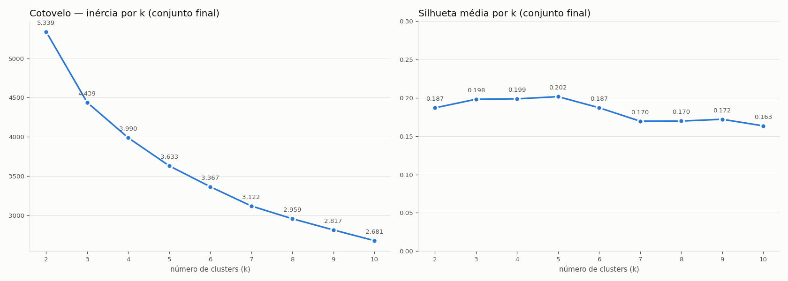

# Retail Store Clustering

Segmentação de 1.115 lojas de varejo por **comparabilidade real**, para substituir a meta única de crescimento por metas definidas dentro de grupos de lojas parecidas.

> Projeto da pós-graduação em Data Analytics e IA Aplicada a Negócios (FNAT), conduzido pelas 6 fases do CRISP-DM.

## Problema

A rede aplicava o mesmo crescimento (+5%) a todas as lojas. Lojas em ponto favorável batiam a meta sem esforço, enquanto lojas pressionadas pela concorrência desistiam no primeiro trimestre. A pergunta de negócio passou a ser:

> Quais lojas são parecidas de verdade, e quem está performando mal em relação aos seus pares — não à rede inteira?

O resultado atende quatro áreas: **Comercial** (metas por grupo), **Trade marketing** (verba promocional), **Supply** (mix e reposição) e **Expansão** (enquadramento de lojas novas).

## Abordagem

- **Aprendizado não supervisionado (clusterização):** não existe rótulo verdadeiro de grupo.
- As categorias cadastrais (`tipo_loja`, `sortimento`) ficam **fora do modelo** e servem como **baseline** a ser superado.
- A solução só é aceita se for **interpretável, acionável, estável, melhor que o baseline e quantificada em R$**.

## Status

| Fase CRISP-DM | Status | Notebook |
|---|---|---|
| 1. Entendimento do Negócio | ✅ Concluída | — |
| 2. Entendimento dos Dados | ✅ Concluída | `02_entendimento_dados.ipynb` |
| 3. Preparação dos Dados | ✅ Concluída | `03_preparacao_dados.ipynb` |
| 4. Modelagem | ✅ Concluída | `04_modelagem.ipynb` |
| 5. Avaliação | ✅ Concluída | `05_avaliacao.ipynb` |
| 6. Deploy | ⏳ Em andamento | `06_deploy.ipynb` |

Decisões, descobertas e critérios de cada fase estão em **[docs/documentacao.md](docs/documentacao.md)**.

## Resultados até aqui

**Features do modelo (6):** venda média por dia, ticket médio, efeito da promoção, volatilidade, sazonalidade e distância ao concorrente, com log1p e padronização (`StandardScaler`).

**Modelo:** K-Means com k = 5 (`SEED = 42`), silhueta de 0,202.

| Cluster | Lojas | Venda média/dia (R$) | Ticket médio (R$) | Efeito da promoção | Sazonalidade | Distância mediana |
|---|---|---|---|---|---|---|
| 0 | 292 | 5.719 | 8,43 | 45,4% | 0,084 | 840 |
| 1 | 414 | 7.084 | 11,35 | 34,9% | 0,092 | 5.835 |
| 2 | 65 | 6.312 | 8,24 | 32,0% | 0,159 | 2.640 |
| 3 | 165 | 6.125 | 9,78 | 70,8% | 0,094 | 4.150 |
| 4 | 179 | 9.545 | 8,04 | 26,3% | 0,076 | 770 |
| Rede | 1.115 | 6.935 | 9,64 | 41,4% | 0,092 | 2.325 |

**Estabilidade:** ARI médio de 0,992 na troca de semente, 0,990 na reordenação das linhas e 0,888 em subamostras de 80% das lojas (critério: ≥ 0,80). Em 100 subamostras, 77,2% das lojas ficam no mesmo cluster em mais de 95% das vezes.

**Contra o baseline:** os clusters explicam 28,3% da variância da venda média (η²), contra 2,8% do `tipo_loja`. Ganham em 9 de 10 métricas de negócio, incluindo 3 que ficaram fora do modelo; perdem só na proporção de domingos abertos (6,6% contra 70,0%), coluna retirada do modelo de propósito.

**Revisão do pipeline:** a primeira versão do modelo reprovou no teste de subamostragem (ARI de 0,755). A causa principal foi aplicar log na sazonalidade, o que apagou o grupo das lojas muito sazonais. A comparação entre os pipelines está na seção 3.6 da documentação.

**Clusters:** 0 · Bairro competitivo de cesta pequena · 1 · Destino de cesta grande · 2 · Sazonal · 3 · Dependente de promoção · 4 · Alto fluxo, cesta pequena.

**Oportunidade:** se as lojas abaixo da mediana do próprio cluster recuperarem 25% do gap, a rede ganha R$ 51,4 mi por ano (2,2% do faturamento).

**Plano de metas ([relatorios/plano_metas_lojas.xlsx](relatorios/plano_metas_lojas.xlsx)):** meta de cada loja pela posição dentro do cluster (2% de manutenção + 25% do gap até a mediana), teto de 20% por loja e calibração para a rede somar exatamente +5% ponderado pelo faturamento. Sem a calibração, as metas somariam só 4,19%.

**Em aberto na Fase 6:** enquadramento de lojas novas.



## Estrutura

```
retail-store-clustering/
├── dados/
│   ├── brutos/          # loja.csv e vendas.csv (não versionados)
│   └── processados/     # bases geradas pelo pipeline
├── notebooks/           # um notebook por fase do CRISP-DM
├── codigo/              # módulos Python reutilizáveis (usados no deploy)
├── modelos/             # artefatos treinados
├── relatorios/figuras/  # gráficos e entregáveis
├── docs/                # documentação do projeto
├── requirements.txt
└── README.md
```

## Dados

| Arquivo | Granularidade | Dimensão |
|---|---|---|
| `loja.csv` | uma linha por loja | 1.115 × 5 |
| `vendas.csv` | uma linha por loja por dia (01/2013 a 07/2015) | 1.017.209 × 9 |

Os arquivos originais não são versionados. Para reproduzir o projeto, coloque-os em `dados/brutos/`.

## Como executar

```bash
git clone https://github.com/V4lciJr/Auroa-Retail-Store-Clustering.git
cd Auroa-Retail-Store-Clustering
python -m venv .venv
.venv\Scripts\activate        # Windows
# source .venv/bin/activate   # Linux / macOS
pip install -r requirements.txt
jupyter notebook notebooks/
```

## Tecnologias

Python 3.10 · pandas · numpy · scipy · scikit-learn · matplotlib · seaborn · Jupyter

## Autor

**Valci Júnior** — [LinkedIn](https://www.linkedin.com/in/valci-junior/)
