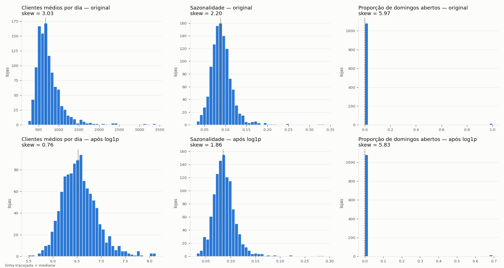
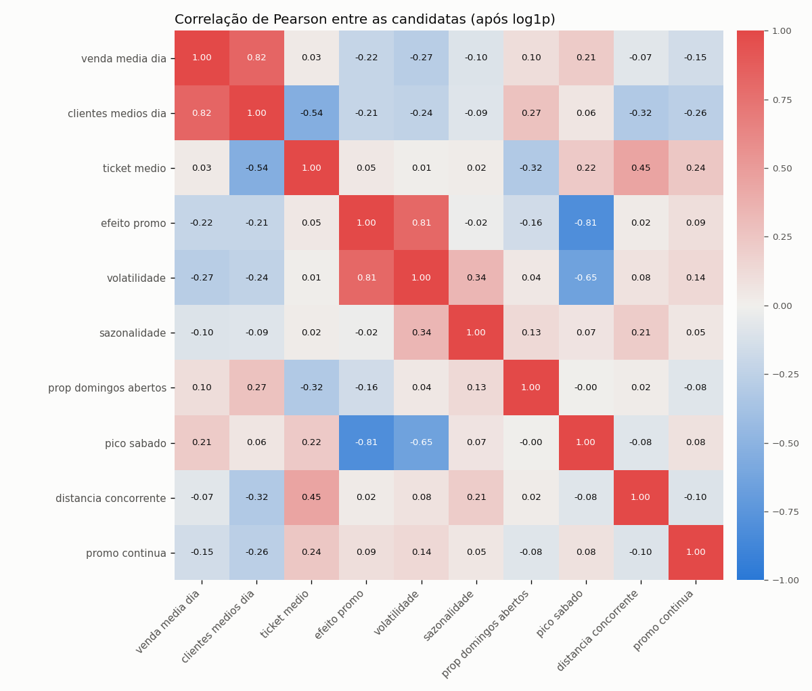
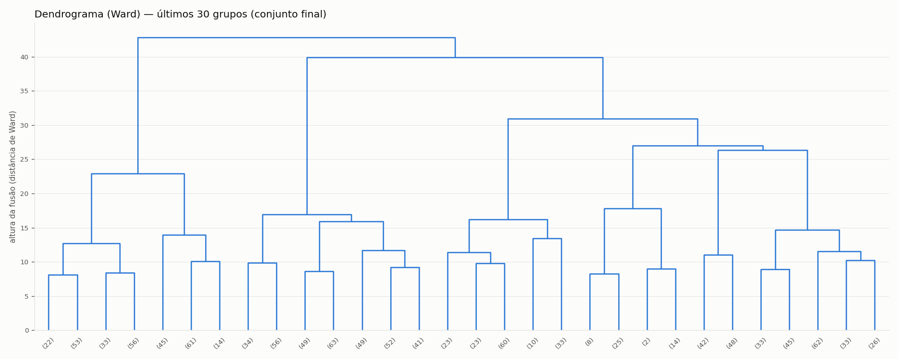

# Documentação — Retail Store Clustering

Segmentação das lojas da Aurora Varejo por comparabilidade real, seguindo o CRISP-DM.

**Status em 07/10/2026:** Fase 5 (Avaliação) em andamento. O ponto exato e as pendências estão na [seção 7](#7-onde-o-projeto-está).

| Fase CRISP-DM | Status | Notebook |
|---|---|---|
| 1. Entendimento do Negócio | Concluída | — |
| 2. Entendimento dos Dados | Concluída | `02_entendimento_dados.ipynb` |
| 3. Preparação dos Dados | Concluída, com o conjunto de features revisado (seção 3.6) | `03_preparacao_dados.ipynb` |
| 4. Modelagem | Concluída: K-Means com k = 5 treinado e salvo sobre o conjunto final | `04_modelagem.ipynb` |
| 5. Avaliação | Em andamento: estabilidade, baseline e perfil médio executados | `05_avaliacao.ipynb` |
| 6. Deploy | Não iniciada | — |

Todos os números deste documento saem das saídas executadas nos notebooks. As figuras ficam em `relatorios/figuras/`; as Fases 2 e 5 não geraram figura (as evidências delas são tabelas).

**Sobre a revisão do pipeline:** a primeira versão do modelo reprovou no teste de estabilidade por subamostragem. O conjunto de features e as transformações foram revisados contra o material de referência do curso, com os dois pipelines medidos pelo mesmo protocolo. A comparação está na seção 3.6. Nos notebooks 03 e 04, as seções anteriores à revisão ficaram como registro e estão marcadas como superadas.

---

## 1. Entendimento do Negócio

**Problema:** a meta única de +5% para as 1.115 lojas deixou de funcionar. Lojas em ponto favorável batem a meta sem esforço; lojas pressionadas (concorrente a poucos metros) desistem no primeiro trimestre.

**Pedido da diretoria:** identificar quais lojas são parecidas de verdade e quem performa mal em relação aos seus pares, não à rede inteira.

**Quem usa o resultado**

| Área | Uso |
|---|---|
| Comercial | Meta por grupo de lojas comparáveis |
| Trade marketing | Onde a verba de promoção gera retorno |
| Supply | Mix de produto e reposição |
| Expansão | Enquadrar uma loja nova antes de ter histórico |

### Decisões de enquadramento

- **Clusterização:** não há rótulo verdadeiro de grupo (não é classificação) e não se pede previsão de venda (não é regressão).
- `tipo_loja` e `sortimento` ficam fora do modelo e são o **baseline** a ser superado.
- O projeto **não** é: previsão de vendas, busca do k matematicamente ótimo, maximização de silhueta.

### Critérios de sucesso e como serão provados

| Critério | Prova |
|---|---|
| Interpretável | Tabela de perfil (medianas e z-score vs rede) por cluster; nome derivado das 2–3 variáveis mais distantes da rede. A validação final é humana. |
| Acionável | Sem medida objetiva. Matriz cluster × área com uma decisão concreta por célula; linhas iguais ⇒ fundir clusters. |
| Estável | ARI médio ≥ 0,80 em 30 reordenações, 30 `random_state` e 30 subamostras de 80%; reportar mínimo e % de lojas que trocam de grupo. |
| Melhor que o baseline | η² dos clusters vs `tipo_loja`/`sortimento` em métricas de negócio, incluindo métricas fora do modelo, partição aleatória e k = 4; ARI/NMI clusters × `tipo_loja`. |
| Quantificado | Gap vs mediana do cluster × dias abertos × % de captura (10/25/50%) em R$/ano; metas ponderadas somando exatamente +5%. |

---

## 2. Entendimento dos Dados

| Indicador | Valor |
|---|---|
| Lojas (`loja.csv`) | 1.115 × 5 colunas |
| Registros diários (`vendas.csv`) | 1.017.209 × 9 colunas |
| Período | 01/01/2013 a 31/07/2015 (942 dias) |
| Venda média por dia aberto | R$ 6.956 |

### Dicionário resumido

| Coluna | Base | Significado | Observação |
|---|---|---|---|
| `loja` | ambas | Identificador, chave de junção | Integridade 100% entre as bases |
| `tipo_loja` / `sortimento` | lojas | Categorias cadastrais | Significado das letras não documentado |
| `distancia_concorrente` | lojas | Distância ao concorrente mais próximo | Unidade não documentada; de 20 a 75.860 |
| `promo_continua` | lojas | Adesão a programa de promoção contínua (fixo por loja) | Sem relação com a promoção diária |
| `dia_semana` | vendas | 1 = segunda … 7 = domingo | Conferido contra a data |
| `faturamento` / `clientes` | vendas | Venda (R$) e clientes do dia | — |
| `aberta` / `promo` | vendas | Loja abriu / promoção ativa no dia | `promo` é calendário da rede (~38% dos dias em todas as lojas) |
| `feriado_estadual` / `feriado_escolar` | vendas | Tipo de feriado (0, a, b, c) / feriado escolar | Significado de a, b, c não documentado |

### Principais descobertas

- **Dias fechados zeram a média:** média sobre todos os dias = média em dia aberto × % de dias abertos (identidade exata). Mede funcionamento, não capacidade de venda; lojas que abrem domingo sobem em média 108 posições no ranking só por isso.
- **Buraco sistemático:** 180 lojas sem nenhuma linha de 01/07/2014 a 31/12/2014 (184 dias, mesmo intervalo em todas). Não aparece como nulo nem zero: as linhas não existem.
- **Soma distorce, média não:** no ranking por soma, 98 das 180 lojas incompletas caem no pior quartil (esperado: 45; p ≈ 10⁻²⁰). Pela média em dia aberto, exatamente 45 (p = 0,54).
- **Registro inconsistente:** 54 linhas com `aberta = 1` e faturamento 0 (52 também com 0 clientes), em 41 lojas. Nenhuma loja fechada com venda.
- **Domingo é raro:** só 33 lojas abrem aos domingos; 17 delas são do tipo `b`.
- **Distância muito assimétrica:** skew 2,93; as 5% lojas mais isoladas concentram 59,6% da variância; após padronização, a mais distante fica a 9,19 desvios. Com log1p: skew −0,35.
- **Distância não explica venda** (Spearman −0,028): é uma dimensão própria de contexto competitivo.
- **3 nulos de distância** (lojas 291, 622, 879) sem perfil comum nem código especial: tratados como falta real.
- **`tipo_loja` é baseline fraco:** os tipos a, c e d vendem praticamente o mesmo (R$ 6.824–6.917 por dia aberto) e a dispersão interna é alta (CV da venda 0,26–0,45).
- **Tipo b é outro negócio:** 17 lojas (1,5%), 2,6× os clientes da rede, ticket de R$ 5,17 (o menor), abrem 98% dos domingos. O modelo deve mantê-las juntas, sem que distorçam as referências dos grupos grandes.

### Colunas do cadastro no modelo

| Coluna | Decisão | Motivo (pergunta de negócio) |
|---|---|---|
| `distancia_concorrente` | **entra** | Contexto competitivo que a loja não escolhe; conhecido antes da abertura (útil para Expansão). |
| `tipo_loja`, `sortimento` | baseline | São a segmentação a superar; no modelo, seriam reconstruídas. |
| `promo_continua` | descrição | Política decidida pela empresa, não comportamento; usá-la tornaria circular a decisão do Trade. |
| `loja` | fora | Identificador. |

### Defeitos encontrados × decisões levadas para a Fase 3

| Defeito | Decisão de engenharia |
|---|---|
| Dias fechados (17% das linhas) zeram as médias | Métricas de desempenho calculadas só sobre dias abertos |
| 54 linhas abertas sem venda | Tratar como dia sem operação: excluir das métricas |
| 180 lojas sem o 2º semestre de 2014 | Só médias, proporções e taxas, nunca somas; métricas temporais devem ser robustas ao período ausente |
| Loja 988 sem 01/01/2013 | Nenhum tratamento específico (coberto pela regra das médias) |
| `promo` igual para toda a rede | Não usar % de dias em promoção; medir a resposta à promoção |
| Proporção de domingos extrema (33 lojas) | Não entra bruta; decidir entre transformar ou manter só como descrição |
| 3 nulos de distância | Imputar e registrar quais lojas foram imputadas |
| Distância com cauda longa | log1p antes de padronizar |
| Escalas diferentes entre variáveis | Padronização (StandardScaler) depois das transformações |
| Extremos do tipo b (clientes, ticket) | Não remover como outlier: é um modelo de negócio real; checar assimetria das novas features |
| `feriado_estadual` com 0 e letras misturados | Ler como texto; se usado, codificar feriado × não feriado |
| `tipo_loja`, `sortimento`, `promo_continua` | Fora da matriz do modelo; preservados para baseline e descrição |

---

## 3. Preparação dos Dados

Notebook: `notebooks/03_preparacao_dados.ipynb` (o conjunto final está na seção 14). Saídas: `base_lojas.parquet`, `X_modelo.parquet` e `modelos/escalonador.joblib`.

### 3.1 Tratamentos

| Tratamento | Resultado |
|---|---|
| Imputação de `distancia_concorrente` pela mediana (2.325) | Lojas 291, 622 e 879, marcadas em `distancia_imputada` |
| Filtro de dias de operação (`aberta = 1` e faturamento > 0) | 844.338 de 1.017.209 linhas; 172.871 removidas (17,0%); as 1.115 lojas continuam presentes |

### 3.2 O buraco do 2º semestre de 2014 distorce as features temporais?

Teste: nas lojas completas, recalcular a feature sem o 2º semestre de 2014, que é o que as 180 lojas incompletas sofrem.

| Feature | Variação mediana sem o período | Spearman entre versões | Conclusão |
|---|---|---|---|
| Volatilidade | −0,2% | 0,994 | O buraco não distorce; calculada no histórico inteiro |
| Sazonalidade | +8,3% | 0,921 | O buraco distorce; precisa de tratamento |

Duas formas de tratar a sazonalidade foram construídas. A que entra no modelo é a normalização pelo ano (seção 3.3); a versão em janela comum (sem o 2º semestre de 2014 para todas as lojas) ficou na base como `sazonalidade_janela_comum`. A correlação entre as duas é de 0,86.

### 3.3 Features criadas (uma linha por loja)

| Bloco | Feature | Como é calculada |
|---|---|---|
| Porte | `venda_media_dia` | Faturamento médio por dia de operação |
| Porte | `clientes_medios_dia` | Clientes médios por dia de operação |
| Porte | `ticket_medio` | Venda média ÷ clientes médios (razão de médias) |
| Promoção | `efeito_promo` | Venda média nos dias com promoção ÷ venda média nos dias sem promoção − 1 |
| Ritmo | `volatilidade` | Coeficiente de variação da venda diária |
| Ritmo | `sazonalidade` | Cada mês dividido pela média do próprio ano da loja; desvio padrão entre os 12 meses |
| Formato | `prop_domingos_abertos` | Domingos abertos ÷ domingos registrados |
| Formato | `pico_sabado` | Venda média de sábado ÷ venda média de segunda a sexta |
| Concorrência | `distancia_concorrente` | Cadastro, com imputação |

Colunas alternativas, mantidas só para descrição:

| Coluna | Diferença para a versão do modelo |
|---|---|
| `efeito_promo_dias_uteis` | Compara promoção × sem promoção só de segunda a sexta (a promoção nunca ocorre no fim de semana) |
| `sazonalidade_janela_comum` | Coeficiente de variação entre os 12 meses, sem o 2º semestre de 2014 para todas as lojas |

- `efeito_promo`: média da rede de +41,4%, faixa de −6,9% a +144,9%, 1 loja com efeito negativo.
- `efeito_promo_dias_uteis`: média de +39,9%, faixa de +1,9% a +102,1%. A correlação entre as duas versões é de 0,76.
- Base final (`base_lojas.parquet`): 1.115 lojas × 16 colunas, sem nulos.

### 3.4 Forma das distribuições

Tratamento final: log1p nas seis features do modelo, depois padronização.

| Feature do modelo | Skew original | Skew após log1p |
|---|---|---|
| `venda_media_dia` | 1,75 | 0,30 |
| `ticket_medio` | 0,28 | −0,30 |
| `efeito_promo` | 0,68 | 0,22 |
| `volatilidade` | 0,72 | 0,55 |
| `sazonalidade` | 2,20 | 1,86 |
| `distancia_concorrente` | 2,93 | −0,35 |

**Figura 1 — `03_histogramas_assimetria.png`.** Linha de cima: distribuição original; linha de baixo: após log1p.

- **Clientes médios por dia:** a cauda à direita some com o log1p (skew 3,03 → 0,76).
- **Sazonalidade:** o log1p quase não muda a forma (2,20 → 1,86), porque os valores vão de 0,03 a 0,34, faixa em que log1p(x) ≈ x.
- **Proporção de domingos abertos:** 1.082 lojas (97,0%) estão em zero e só 33 abrem. Log1p, binarização, Yeo-Johnson e quantil deixam o skew entre 5,56 e 5,97: nenhuma transformação cria variação onde há um valor só. A coluna ficou fora do modelo e segue como descrição.

**A cauda da sazonalidade é um grupo real, não ruído.** A primeira versão do pipeline aplicou log puro na sazonalidade para zerar a assimetria. Isso apagou o grupo das lojas muito sazonais e foi a principal causa da instabilidade do primeiro modelo (seção 3.6):

| Sazonalidade | Skew | Lojas acima de 2 desvios | z máximo |
|---|---|---|---|
| Original | 2,20 | 31 | 8,94 |
| log1p | 1,86 | 31 | 8,28 |
| log | 0,07 | 27 | 4,85 |

### 3.5 Correlação entre as candidatas

**Figura 2 — `03_matriz_correlacao.png`.** Pares com |r| ≥ 0,4:

| Par | Pearson |
|---|---|
| `venda_media_dia` × `clientes_medios_dia` | 0,82 |
| `efeito_promo` × `pico_sabado` | −0,81 |
| `efeito_promo` × `volatilidade` | 0,81 |
| `volatilidade` × `pico_sabado` | −0,65 |
| `clientes_medios_dia` × `ticket_medio` | −0,54 |
| `ticket_medio` × `distancia_concorrente` | 0,45 |

- **Clientes:** venda = clientes × ticket é identidade exata (erro máximo 0,0). Manter os três seria contar o porte duas vezes; `clientes_medios_dia` ficou fora.
- **`efeito_promo` × `pico_sabado` (−0,81):** os dias sem promoção incluem os sábados, então parte do efeito medido é o padrão semanal. Na versão só com dias úteis, a correlação com `pico_sabado` é de −0,26.
- **`efeito_promo` × `volatilidade` (0,81):** par mantido de propósito. A promoção interessa ao Trade e a volatilidade ao Supply; o preço é dar peso maior a essa dimensão no modelo.

### 3.6 Revisão do pipeline e features do modelo

O primeiro modelo usava `pico_sabado` no lugar de `volatilidade`, o efeito da promoção só em dias úteis, a sazonalidade em janela comum e log apenas nas colunas assimétricas (log puro na sazonalidade). Em k = 5, ele reprovou no teste de subamostragem. Quatro pipelines foram medidos pelo mesmo protocolo: 30 trocas de semente, 30 reordenações e 100 subamostras de 80% das lojas.

| Pipeline (k = 5) | Silhueta | ARI semente | ARI reordenação | ARI subamostra | Subamostras abaixo de 0,80 | Menor / maior cluster |
|---|---|---|---|---|---|---|
| 1. Anterior (log na sazonalidade) | 0,180 | 0,900 | 0,907 | 0,755 | 51% | 147 / 343 |
| 2. Anterior, trocando só log por log1p na sazonalidade | 0,183 | 0,893 | 0,900 | 0,815 | 24% | 71 / 346 |
| 3. Features anteriores + log1p nas seis | 0,184 | 0,982 | 0,986 | 0,892 | 13% | 65 / 387 |
| 4. Features finais + log1p nas seis | 0,202 | 0,992 | 0,990 | 0,898 | 14% | 65 / 414 |

Variância explicada (η², em %) pelos clusters de cada pipeline:

| Métrica | `tipo_loja` | Pipeline 1 | Pipeline 3 | Pipeline 4 |
|---|---|---|---|---|
| `venda_media_dia` | 2,8 | 14,5 | 16,5 | 28,3 |
| `ticket_medio` | 42,3 | 54,1 | 53,5 | 50,6 |
| `clientes_medios_dia` | 25,5 | 25,3 | 27,2 | 36,7 |
| `efeito_promo` | 8,4 | 45,0 | 45,4 | 57,8 |
| `efeito_promo_dias_uteis` | 6,0 | 39,2 | 36,1 | 29,0 |
| `volatilidade` | 2,0 | 38,8 | 42,4 | 60,8 |
| `sazonalidade` | 3,1 | 31,9 | 35,4 | 43,2 |
| `sazonalidade_janela_comum` | 2,9 | 41,3 | 44,1 | 33,9 |
| `pico_sabado` | 22,4 | 47,6 | 48,7 | 43,4 |
| `distancia_concorrente` | 2,5 | 19,6 | 20,9 | 20,7 |
| **Média** | 11,8 | 35,7 | 37,0 | 40,5 |

- A estabilidade vem da transformação: com log1p nas seis, o conjunto anterior (pipeline 3) empata com o final (0,892 contra 0,898).
- A escolha das features decide o poder de explicação: o pipeline 4 explica 28,3% da venda, contra 16,5% do pipeline 3. A venda é a métrica da meta.
- O pipeline 4 foi adotado.

**Features do modelo (6):**

| Feature | Dimensão | Média aprendida (em log1p) | Desvio aprendido (em log1p) |
|---|---|---|---|
| `venda_media_dia` | Porte | 8,7934 | 0,3138 |
| `ticket_medio` | Padrão de compra | 2,3473 | 0,1898 |
| `efeito_promo` | Resposta à promoção | 0,3387 | 0,1255 |
| `volatilidade` | Oscilação diária | 0,2392 | 0,0453 |
| `sazonalidade` | Variação ao longo do ano | 0,0873 | 0,0244 |
| `distancia_concorrente` | Contexto competitivo | 7,6457 | 1,5495 |

Ficam fora do modelo: `clientes_medios_dia` (redundante com venda e ticket), `pico_sabado` (padrão semanal já presente no efeito da promoção e na volatilidade), `prop_domingos_abertos` (97,0% de zeros), `promo_continua` (política da empresa), `tipo_loja` e `sortimento` (baseline).

Matriz final (`X_modelo.parquet`): 1.115 × 6, sem nulos, média 0 e desvio 1. A loja mais sazonal fica a 8,29 desvios da média.

---

## 4. Modelagem

Notebook: `notebooks/04_modelagem.ipynb` (a modelagem sobre o conjunto final está na seção 6). Saídas: `modelos/kmeans_k5.joblib` e `base_lojas_clusters.parquet`.

### 4.1 K-Means de k = 2 a 10

`n_init = 20`, `random_state = 42`.

| k | Inércia | Silhueta | Menor cluster | Maior cluster |
|---|---|---|---|---|
| 2 | 5.338,8 | 0,187 | 512 | 603 |
| 3 | 4.439,0 | 0,198 | 316 | 458 |
| 4 | 3.989,6 | 0,199 | 133 | 442 |
| 5 | 3.632,6 | 0,202 | 65 | 414 |
| 6 | 3.366,5 | 0,187 | 62 | 388 |
| 7 | 3.121,7 | 0,170 | 64 | 253 |
| 8 | 2.959,4 | 0,170 | 39 | 231 |
| 9 | 2.817,1 | 0,172 | 31 | 223 |
| 10 | 2.680,9 | 0,163 | 22 | 193 |

**Figura 3 — `04_cotovelo_silhueta.png`.**

- **Cotovelo (esquerda):** a inércia cai de forma suave, sem dobra evidente. O cotovelo geométrico (ponto mais distante da reta entre k = 2 e k = 10) é k = 5, com distância 0,267; k = 4 (0,258) e k = 6 (0,242) ficam próximos.
- **Silhueta (direita):** máxima em k = 5 (0,202), quase empatada com k = 3 (0,198) e k = 4 (0,199); cai a partir de k = 6.
- **Contra o acaso:** na mesma base com cada coluna embaralhada, a silhueta fica entre 0,117 e 0,129. O ganho da base real é de 0,039 a 0,081 (0,078 em k = 5). A estrutura existe, mas a separação entre os grupos é baixa.

### 4.2 Segunda opinião: clusterização hierárquica (Ward)

**Figura 4 — `04_dendrograma.png`.** Cada folha é um grupo, com o número de lojas entre parênteses. Quanto maior a faixa de altura sem fusão, mais natural é cortar ali.

| Corte em | Faixa de altura do corte | Folga |
|---|---|---|
| 2 grupos | 39,90 a 42,82 | 2,93 |
| 3 grupos | 30,94 a 39,90 | 8,95 |
| 4 grupos | 26,99 a 30,94 | 3,95 |
| 5 grupos | 26,33 a 26,99 | 0,66 |
| 6 grupos | 22,93 a 26,33 | 3,40 |
| 7 grupos | 17,78 a 22,93 | 5,15 |
| 8 grupos | 16,96 a 17,78 | 0,82 |

- As maiores folgas estão nos cortes em 3 grupos (8,95) e em 7 grupos (5,15). O corte em 5 grupos tem folga pequena (0,66): o dendrograma aponta a faixa de 3 a 7 grupos, sem destacar o 5.
- O hierárquico não reproduz o K-Means: o ARI entre os dois métodos vai de 0,31 a 0,45 (0,387 em k = 5), e a silhueta do hierárquico é menor (0,135 contra 0,202 em k = 5).
- Custo: a matriz de distâncias cresce com n². Medido nesta máquina: 0,011 s para 1.115 lojas e 2,44 s para 10.000. Calculado: 0,4 GB de memória para 10.000 pontos e 40 GB para 100.000.

### 4.3 Candidatos de k contra os critérios da Fase 1

Estabilidade medida em 30 repetições de cada teste (ARI médio). O η² médio é a média de 8 métricas de negócio; o gap anual é a soma, nas lojas abaixo da mediana do próprio cluster, da distância até essa mediana.

| k | Silhueta | ARI semente | ARI reordenação | ARI subamostra 80% | η² médio (%) | η² da venda (%) | Gap anual (R$ mi) | Menor cluster |
|---|---|---|---|---|---|---|---|---|
| 2 | 0,187 | 1,000 | 1,000 | 0,859 | 20,3 | 10,3 | 211,5 | 512 |
| 3 | 0,198 | 0,992 | 0,990 | 0,925 | 30,0 | 13,6 | 201,5 | 316 |
| 4 | 0,199 | 0,984 | 0,984 | 0,911 | 37,3 | 15,9 | 207,6 | 133 |
| 5 | 0,202 | 0,992 | 0,990 | 0,888 | 42,7 | 28,3 | 205,5 | 65 |
| 6 | 0,187 | 0,949 | 0,951 | 0,737 | 43,9 | 34,8 | 189,8 | 62 |
| 8 | 0,170 | 0,655 | 0,671 | 0,672 | 49,6 | 35,5 | 178,3 | 39 |

Referência do `tipo_loja`: η² médio de 13,6% e η² da venda de 2,8%.

- k = 5 é o maior k que passa nos três testes de estabilidade (ARI ≥ 0,80), e tem a maior silhueta.
- De k = 4 para k = 5, a venda explicada sobe de 15,9% para 28,3%.
- k = 6 e k = 8 explicam mais, mas reprovam na subamostragem (0,737 e 0,672).
- Decisão: k = 5.

### 4.4 Registro: o primeiro modelo

O primeiro modelo (pipeline 1 da seção 3.6) também usava k = 5. Tinha inércia de 3.890,5, silhueta de 0,180 e clusters de 343, 147, 258, 179 e 188 lojas. Reprovou na subamostragem (ARI 0,754), e uma solução de inércia 0,17% menor movia 53 lojas. As seções 1 a 5 do notebook 04 guardam essa análise.

### 4.5 Modelo final: K-Means com k = 5

Inércia de 3.632,6 e silhueta de 0,202. Com `n_init = 500`, a inércia é de 3.632,5 e só 2 lojas mudam de cluster (ARI 0,997): o modelo salvo é, na prática, a melhor solução que o K-Means encontra.

| Cluster | Lojas | % da rede | Silhueta média | % com silhueta negativa |
|---|---|---|---|---|
| 0 | 292 | 26,2 | 0,165 | 5,1 |
| 1 | 414 | 37,1 | 0,278 | 0,0 |
| 2 | 65 | 5,8 | 0,079 | 33,8 |
| 3 | 165 | 14,8 | 0,198 | 7,9 |
| 4 | 179 | 16,1 | 0,131 | 18,4 |

Centroides em desvios-padrão da rede (z):

| Feature | C0 | C1 | C2 | C3 | C4 |
|---|---|---|---|---|---|
| `venda_media_dia` | −0,56 | 0,14 | −0,26 | −0,37 | 1,02 |
| `ticket_medio` | −0,59 | 0,84 | −0,72 | 0,12 | −0,84 |
| `efeito_promo` | 0,26 | −0,34 | −0,54 | 1,54 | −0,87 |
| `volatilidade` | 0,08 | −0,35 | 0,70 | 1,56 | −1,02 |
| `sazonalidade` | −0,28 | 0,04 | 2,44 | 0,09 | −0,60 |
| `distancia_concorrente` | −0,70 | 0,62 | 0,21 | 0,40 | −0,73 |

- O maior cluster (1, com 37,1% da rede) é o mais coeso: maior silhueta e nenhuma loja com silhueta negativa.
- O menor cluster (2, com 65 lojas) é definido pela sazonalidade (+2,44 desvios). É o de menor silhueta: 33,8% das suas lojas estão mais perto de outro grupo.

Variáveis que ficaram fora do modelo:

| Cluster | `promo_continua` (%) | Lojas que abrem domingo | Tipo a | Tipo b | Tipo c | Tipo d |
|---|---|---|---|---|---|---|
| 0 | 50,0 | 3 | 199 | 2 | 51 | 40 |
| 1 | 57,5 | 1 | 113 | 0 | 36 | 265 |
| 2 | 53,8 | 13 | 38 | 2 | 22 | 3 |
| 3 | 55,8 | 3 | 127 | 0 | 9 | 29 |
| 4 | 33,5 | 13 | 125 | 13 | 30 | 11 |
| Rede | 51,2 | 33 | 602 | 17 | 148 | 348 |

- Associação com os clusters: V de Cramér de 0,166 para `promo_continua` e de 0,288 para abrir domingo.
- 26 das 33 lojas que abrem domingo estão nos clusters 2 e 4, sem que a coluna de domingo tenha entrado no modelo.
- 13 das 17 lojas do tipo b estão no cluster 4; 265 das 348 do tipo d estão no cluster 1.

---

## 5. Avaliação (em andamento)

Notebook: `notebooks/05_avaliacao.ipynb`. Os critérios da Fase 1 são cobrados um por vez sobre o K-Means com k = 5. Executados até aqui: estabilidade, comparação com o baseline e perfil médio. Esta fase ainda não gerou figura.

### 5.1 Estabilidade

Reexecutar com a mesma semente e a mesma base devolve exatamente os mesmos grupos (ARI 1,0 em 5 reexecuções).

| Teste (30 execuções) | ARI médio | ARI mínimo | Execuções abaixo de 0,80 | % de lojas que trocam (média) | % de lojas que trocam (pior caso) |
|---|---|---|---|---|---|
| Troca de semente | 0,992 | 0,978 | 0 | 0,4 | 1,0 |
| Reordenação das linhas | 0,990 | 0,968 | 0 | 0,5 | 1,6 |
| Subamostra de 80% | 0,888 | 0,690 | 5 | 5,4 | 20,6 |

Contra o critério da Fase 1 (ARI médio ≥ 0,80): **atendido nos três testes**. Com 100 subamostras, o ARI médio é de 0,898 e 14% delas ficam abaixo de 0,80.

Estabilidade por loja, em 100 subamostras de 80%:

| Permanência no mesmo cluster | Lojas | % |
|---|---|---|
| Acima de 95% | 861 | 77,2 |
| 80% a 95% | 130 | 11,7 |
| 50% a 80% | 119 | 10,7 |
| Até 50% | 5 | 0,4 |

| Cluster | Permanência média | % de lojas abaixo de 80% |
|---|---|---|
| 0 | 0,920 | 18,8 |
| 1 | 0,981 | 2,7 |
| 2 | 0,934 | 9,2 |
| 3 | 0,930 | 20,0 |
| 4 | 0,947 | 9,5 |

- 124 lojas (11,1%) ficam no mesmo cluster em menos de 80% das subamostras. Elas se concentram nos clusters 0 e 3.
- Lojas instáveis são as de fronteira: silhueta média de 0,033 nas instáveis (< 80%) contra 0,245 nas estáveis (> 95%); Spearman entre silhueta e permanência de 0,683.

### 5.2 Os clusters são melhores que o cadastro?

**Teste A — concordância com o cadastro**

| Categoria | ARI | NMI |
|---|---|---|
| `tipo_loja` | 0,118 | 0,148 |
| `sortimento` | 0,056 | 0,065 |

Os clusters não reconstroem o cadastro. As maiores concentrações: 76,1% das lojas do tipo d estão no cluster 1 e 76,5% das lojas do tipo b estão no cluster 4.

**Teste B — variância explicada (η², em %)**

O η² é a parcela da variação de uma métrica explicada pelo grupo da loja (variação entre as médias dos grupos ÷ variação total).

| Métrica | Origem | `tipo_loja` | `sortimento` | Cluster | Aleatório |
|---|---|---|---|---|---|
| `venda_media_dia` | no modelo | 2,8 | 2,5 | 28,3 | 0,3 |
| `ticket_medio` | no modelo | 42,3 | 11,1 | 50,6 | 0,4 |
| `efeito_promo` | no modelo | 8,4 | 9,3 | 57,8 | 0,4 |
| `volatilidade` | no modelo | 2,0 | 1,5 | 60,8 | 0,4 |
| `sazonalidade` | no modelo | 3,1 | 10,1 | 43,2 | 0,3 |
| `distancia_concorrente` | no modelo | 2,5 | 2,4 | 20,7 | 0,3 |
| `clientes_medios_dia` | fora | 25,5 | 10,9 | 36,7 | 0,4 |
| `pico_sabado` | fora | 22,4 | 5,4 | 43,4 | 0,4 |
| `efeito_promo_dias_uteis` | fora | 6,0 | 6,9 | 29,0 | 0,3 |
| `prop_domingos_abertos` | fora | 70,0 | 37,4 | 6,6 | 0,4 |

| Média de η² | `tipo_loja` | Cluster |
|---|---|---|
| Métricas no modelo | 10,2 | 43,6 |
| Métricas fora do modelo | 31,0 | 28,9 |

- Os clusters ganham em 9 das 10 métricas, incluindo 3 que ficaram fora do modelo (clientes, pico de sábado e efeito da promoção em dias úteis).
- A única derrota é a proporção de domingos abertos (6,6 contra 70,0), coluna retirada do modelo de propósito. É ela que puxa a média fora do modelo para baixo do `tipo_loja`.
- O ganho não vem do número de grupos: uma divisão aleatória com os mesmos tamanhos explica de 0,3% a 0,4%, e o K-Means com k = 4 (mesmo número de grupos do `tipo_loja`) também ganha em 9 das 10 métricas.
- Dentro dos clusters, o coeficiente de variação da venda é de 0,284, contra 0,351 dentro do `tipo_loja` e 0,344 na rede inteira.

### 5.3 Perfil médio de cada cluster

Médias por cluster; a distância é a mediana.

| Métrica | C0 | C1 | C2 | C3 | C4 | Rede |
|---|---|---|---|---|---|---|
| Lojas | 292 | 414 | 65 | 165 | 179 | 1.115 |
| Venda média/dia (R$) | 5.719 | 7.084 | 6.312 | 6.125 | 9.545 | 6.935 |
| Clientes/dia | 693 | 634 | 793 | 630 | 1.235 | 755 |
| Ticket médio (R$) | 8,43 | 11,35 | 8,24 | 9,78 | 8,04 | 9,64 |
| Efeito da promoção | 45,4% | 34,9% | 32,0% | 70,8% | 26,3% | 41,4% |
| Efeito da promoção (dias úteis) | 41,6% | 39,3% | 31,8% | 52,9% | 29,7% | 39,9% |
| Volatilidade | 0,275 | 0,251 | 0,312 | 0,364 | 0,213 | 0,272 |
| Sazonalidade | 0,084 | 0,092 | 0,159 | 0,094 | 0,076 | 0,092 |
| Pico de sábado | 0,750 | 0,921 | 0,891 | 0,524 | 0,931 | 0,817 |
| Distância mediana | 840 | 5.835 | 2.640 | 4.150 | 770 | 2.325 |
| `promo_continua` | 50,0% | 57,5% | 53,8% | 55,8% | 33,5% | 51,2% |
| Proporção de domingos abertos | 0,9% | 0,2% | 13,5% | 1,2% | 7,2% | 2,4% |
| Lojas que abrem domingo | 3 | 1 | 13 | 3 | 13 | 33 |

Os clusters ainda não têm nome: a nomeação faz parte do critério "interpretável", ainda não executado.

---

## 6. Deploy

Não iniciado. A pasta `codigo/` (funções reutilizáveis de preparação, features, modelo e inferência) ainda está vazia.

---

## 7. Onde o projeto está

**Ponto atual:** Fase 5, com três blocos executados (estabilidade, comparação com o baseline e perfil médio) sobre o modelo revisado.

Situação de cada critério de sucesso da Fase 1:

| Critério | Situação | Evidência até aqui |
|---|---|---|
| Estável | Atendido | ARI de 0,992 (semente), 0,990 (reordenação) e 0,888 (subamostra de 80%) |
| Melhor que o baseline | Atendido, com uma ressalva | Ganha em 9 de 10 métricas; perde em domingos abertos, coluna fora do modelo |
| Interpretável | Em andamento | Perfil médio e centroides prontos; clusters sem nome |
| Acionável | Pendente | Matriz cluster × área não construída |
| Quantificado | Pendente | Só a prévia da Fase 4 (gap de R$ 205,5 mi/ano em k = 5); faltam os cenários de captura e as metas somando +5% |

Ressalvas registradas:

- **O efeito da promoção mistura o padrão semanal.** Os dias sem promoção incluem os sábados; a correlação de `efeito_promo` com `pico_sabado` é de −0,81.
- **A promoção pesa mais no modelo.** `efeito_promo` e `volatilidade` têm correlação de 0,81 e entram as duas.
- **O cluster 2 é estável, mas pouco coeso.** Permanência média de 0,934 nas subamostras, com silhueta de 0,079 e 33,8% das lojas com silhueta negativa.
- **124 lojas de fronteira** trocam de cluster em mais de 20% das subamostras.

Pendências fora da análise:

- **Versionamento:** o último commit é "fases 3, 4 e inicio da 5 do CRISP-DM". A revisão do pipeline ainda não foi commitada: notebooks 03, 04 e 05, as 4 figuras, os 2 artefatos em `modelos/`, o README e este documento.
- **`base_lojas_transformada.parquet`** é do primeiro modelo e não é mais usada.

### Artefatos gerados

| Arquivo | Fase | Conteúdo |
|---|---|---|
| `dados/processados/base_lojas.parquet` | 3 | 1.115 lojas × 16 colunas, em unidade original |
| `dados/processados/X_modelo.parquet` | 3 | 6 features em log1p, padronizadas |
| `modelos/escalonador.joblib` | 3 | `StandardScaler` ajustado sobre o log1p das 6 features |
| `modelos/kmeans_k5.joblib` | 4 | K-Means com k = 5 |
| `dados/processados/base_lojas_clusters.parquet` | 4 | Base com o cluster de cada loja |
| `relatorios/figuras/03_histogramas_assimetria.png` | 3 | Figura 1 |
| `relatorios/figuras/03_matriz_correlacao.png` | 3 | Figura 2 |
| `relatorios/figuras/04_cotovelo_silhueta.png` | 4 | Figura 3 |
| `relatorios/figuras/04_dendrograma.png` | 4 | Figura 4 |

Os dados em `dados/` não são versionados (`.gitignore`).

---

## 8. Ambiente

Python 3.10 · pandas 2.3.3 · numpy 2.2.6 · scipy 1.15.3 · scikit-learn 1.7.2 · matplotlib 3.10.9 · seaborn 0.13.2 · `SEED = 42`
